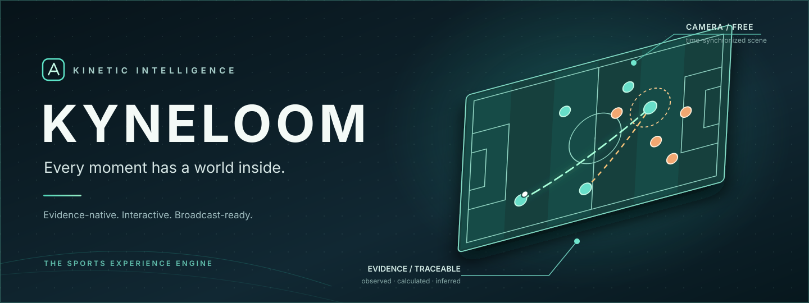
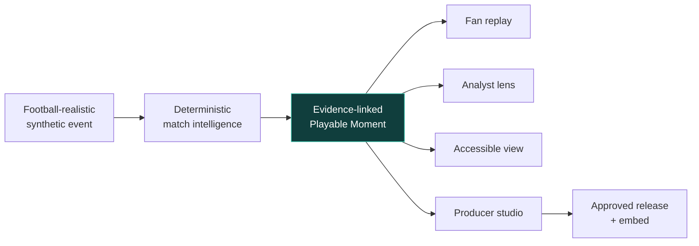
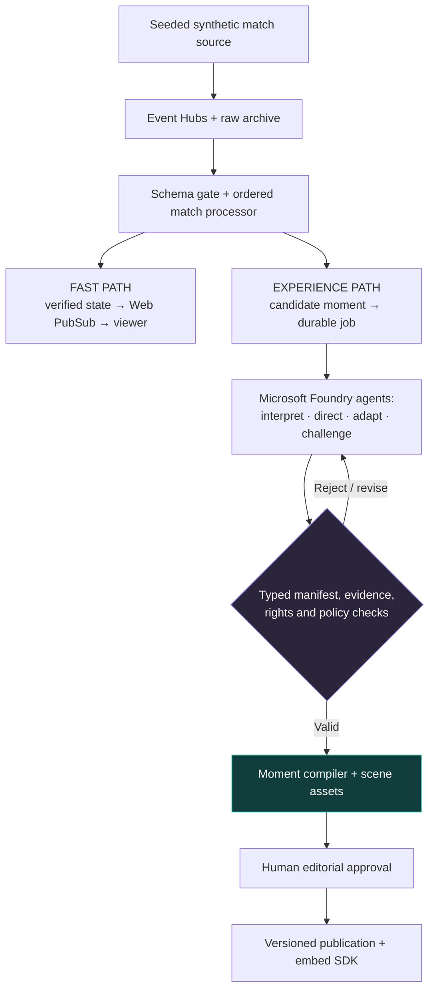

<div align="center">
  
  <br />
  <h1>KYNELOOM</h1>
  <p><strong>Every moment has a world inside.</strong></p>
  <p><em>The evidence-native experience engine for interactive sports.</em></p>
  <p>
    <a href="#-the-idea">The idea</a> ·
    <a href="#-one-moment-four-experiences">The experience</a> ·
    <a href="#-system-design">Architecture</a> ·
    <a href="#-documentation">Documentation</a> ·
    <a href="#-delivery-status">Status</a>
  </p>
  <p>
    
    
    
  </p>
</div>

> [!IMPORTANT]
> **Build status — specification-first.** This repository contains a runnable engineering foundation (typed pnpm monorepo, web shell, application CI — [KYN-01](https://github.com/CosmasMandikonza/Kyneloom/issues/1)) alongside the product documentation. The live event pipeline, AI agents, 3D renderer, production studio, and publishing service described below are **planned systems, not deployed or implemented features**. We will update the status with verified working capabilities as development progresses. No invented demos, performance claims, or customer logos.

> **Start building:** [31 ordered GitHub issues and parallel founder lanes](https://github.com/CosmasMandikonza/Kyneloom/issues/29) · [Agent handoff playbook](docs/18-execution-board.md). Each issue includes direct Suzie Code/Codex prompts, verified behavior requirements and PR acceptance criteria.

## ✦ The idea

A goal is scored. Everyone sees the finish. But the run that pulled a defender away, the space it opened, and the decision that made the goal possible can be almost invisible.

**Kyneloom turns a match moment into something you can enter, investigate, explain, compose, and publish.**

Instead of generating another chatbot answer, static analytics dashboard, or highlight clip, the platform is designed to produce a **Playable Moment**: a time-synchronized interactive scene built from football-realistic event and positional data, with evidence-linked explanations and audience-aware presentation.

A single trusted moment can be experienced as a cinematic replay, tactical exploration, accessible audio description, or editable broadcast package.

**Our thesis:** sports media should be programmable, inspectable, and interactive—not limited to one fixed camera or one fixed interpretation.

## ◈ One moment. Four experiences.

| **01 · Enter the moment** | **02 · Understand what matters** |
|:---|:---|
| Orbit a football moment, scrub time, follow a player, and move between fluid camera perspectives. | Select a pass, run, or defensive gap to reveal observed evidence, measured geometry, and clearly labeled hypotheses. |
| **03 · Direct the experience** | **04 · Publish it anywhere** |
| A producer edits an AI-proposed shot list, narration, overlays, and audience variants—with approval controls. | A versioned scene manifest becomes an interactive web experience or an authorized embed, not merely an exported video. |

### One canonical event; multiple ways to see it



**Perspectives are not account types.** Fans can explore an analyst lens. Permissions govern what a user may *edit, approve, publish, or administer*; perspectives govern how they *experience* the scene.

## ◇ The engine: more than a 3D pitch

| Capability | What makes it meaningful |
|---|---|
| **Living Replay** | Time-consistent 3D and 2D replay driven by versioned trajectories, not a pre-baked animation presented as data. |
| **Evidence X-Ray** | Objective assertions connect to source events and deterministic calculations; tactical interpretations are labeled as hypotheses. |
| **Experience Compiler** | AI proposes a constrained, versioned `MomentManifest`. The viewer never executes model-written JavaScript. |
| **Editorial Studio** | Producers inspect a proposed experience, revise it, approve a specific version, and can revoke publication. |
| **Audience Lenses** | Fan, analyst, producer-preview and accessibility experiences share the same authoritative match state. |
| **Match Laboratory** | Seeded synthetic fixtures, missing-tracking tests, out-of-order records, and adversarial agent scenarios. |

For the exact product journey, see **[Experience specification](docs/02-experience-design.md)**. For the data and rendering contracts, see **[Event contracts](docs/05-data-and-event-contracts.md)** and **[Moment Manifest](docs/06-moment-manifest.md)**.

## ⌘ System design

**Two execution paths.** Real-time updates must not wait on model inference; selected, high-value moments enter a durable creative workflow.



**Proposed stack** · Next.js / TypeScript · React Three Fiber / Three.js · Microsoft Foundry + Agent Framework · Azure Event Hubs · Azure Container Apps · PostgreSQL · Blob Storage · Web PubSub · OpenTelemetry · Bicep.

These are **target architectural choices**, not an assertion that the services are already provisioned. Fabric Eventhouse is an optional historical analytics path, **not** part of the latency-critical viewer flow.

Architecture decisions and trade-offs: **[System architecture](docs/04-system-architecture.md)** · **[Agents](docs/07-agent-orchestration.md)** · **[Azure topology](docs/09-azure-platform.md)**.

## ⚑ What we will not fake

- **No fictional player positions passed off as observed tracking.** The renderer labels `observed`, `synthetic`, `interpolated`, and `inferred` motion.
- **No LLM-calculated statistics.** Distances, event sequences, and objective numbers come from deterministic code.
- **No “six agents” theater.** Each agent must have a bounded task, typed output, measurable contribution, and recovery behavior.
- **No release without authority.** Publication requires real authorization, rights checks, and auditable approval.
- **No decorative infrastructure.** We measure the services we use, run replay/failure tests, and compare with simpler baselines.
- **No fake screenshots, passing badges, deployed URLs, or benchmark numbers.** Evidence follows implementation.

## ✧ Documentation

| Start here | Purpose |
|---|---|
| **[Documentation hub](docs/README.md)** | Reading order, ownership, cross-links, and decision map |
| [Vision & product boundaries](docs/01-product-vision.md) | Customer, wedge, north-star experience, non-goals |
| [Experience & flows](docs/02-experience-design.md) | Entry paths, fan/analyst/producer journeys, state transitions |
| [Visual and interaction system](docs/03-design-system.md) | Cinematic identity, 3D/2D composition, motion, responsive/accessibility requirements |
| [System architecture](docs/04-system-architecture.md) | Data plane vs. control plane, durability, scaling, failure handling |
| [Event & tracking contracts](docs/05-data-and-event-contracts.md) | Canonical event envelope, coordinate system, revision semantics |
| [Moment Manifest](docs/06-moment-manifest.md) | Versioned schema, validation, publication state |
| [Agents & tools](docs/07-agent-orchestration.md) | Specialized roles, workflow gates, evaluation, tool security |
| [3D replay engine](docs/08-3d-engine.md) | Camera rig, interpolation, motion truthfulness, rendering budget |
| **[Realistic footballer asset pipeline](docs/19-realistic-character-pipeline.md)** | Licensed rigged players, mocap-style animation, stadium environment and source-anchored motion |
| [Azure architecture](docs/09-azure-platform.md) | Service responsibilities, environments, IaC and observability |
| [Security, rights & privacy](docs/10-security-and-rights.md) | Tenant isolation, publish authority, threat model |
| [Quality & evaluation](docs/11-evaluation-and-reliability.md) | Replay fixtures, fault injection, product metrics, acceptance gates |
| [Delivery roadmap](docs/12-delivery-roadmap.md) | Two-founder ownership, milestones, definition of done |
| [Competition evidence](docs/13-hackathon-submission.md) | Judging alignment without overclaiming |
| [Competitive landscape](docs/14-competitive-landscape.md) | Inspiration, differentiation hypotheses, commercial risks |
| **[Football intelligence (KYN-12)](docs/21-football-intelligence.md)** | Versioned metrics, source-quality policy, meaningful-moment detection, agent tool boundary |
| **[Moment compiler (KYN-16)](docs/22-moment-compiler.md)** | Untrusted typed proposals → deterministic, content-hashed Playable Moment manifests; synchronized overlay + recap; the KYN-15 Foundry boundary |
| **[Competition gallery radar — 13 Oct](docs/20-competitive-radar-2026-10-13.md)** | 128 reported / 126 visible descriptions, closest rivals, overlap, evidence limits and decisions |
| [References](docs/REFERENCES.md) | Primary technical and product sources |
| [First build: Playable Moment](docs/15-first-vertical-slice.md) | Golden fixture, proposed APIs, founder handoffs, build stories |\n| [Execution board & agent handoff](docs/18-execution-board.md) | Parallel founder workflow, issue order, copy-ready agent prompt and quality stoplights |
| [Visual engineering & QA](docs/16-visual-reference-and-qa.md) | Source-grounded UI research and required screenshot/performance review |
| **[Source-verified frontend implementation](docs/17-source-verified-frontend.md)** | Inspected Cult UI, React Bits, Skiper UI and 2026 3D engineering source; concrete integration plan, UI rejection rules and visual proof |\n| [Decision records](docs/decisions/0001-dual-path-architecture.md) | Why the platform is designed this way |

> **For AI coding agents and contributors:** read **[AGENTS.md](AGENTS.md)** before changing code or UI. Contracts and ADRs are the source of truth, not screenshots or an assistant's memory.

## ◉ Delivery status

This is an intentionally **honest** tracker; checkboxes are updated only when evidence exists.

- [x] Product positioning, roles, architecture proposal, data-contract drafts and design constraints documented
- [x] Runnable TypeScript monorepo foundation: pnpm workspace, strict TS, lint/format/typecheck/test/build scripts, tested package-boundary rule, fixture seam and application CI ([KYN-01](https://github.com/CosmasMandikonza/Kyneloom/issues/1))
- [ ] Real 3D replay with timestamp-correct scene playback
- [x] Seeded deterministic synthetic match generator with contract-valid golden fixture and fault-injection variants ([KYN-03](https://github.com/CosmasMandikonza/Kyneloom/issues/3))
- [x] Authoritative event-time reducer: supersession/corrections, deterministic match state, truthful timeline sampling, separation evidence metric ([KYN-04](https://github.com/CosmasMandikonza/Kyneloom/issues/4))
- [ ] Working Foundry orchestration with verifiable trace and evaluation
- [ ] Scene manifest compiler with actual source-linked evidence
- [ ] Producer approval, authorized publication and replayable embed
- [ ] CI tests, reproducible Azure deployment, security checks and measured benchmarks
- [ ] Recorded end-to-end demo using the implemented system

See [delivery roadmap](docs/12-delivery-roadmap.md) for milestone exit criteria, team responsibilities, and measurable acceptance tests.

### Documentation quality

The repo includes a zero-dependency [Markdown integrity checker](scripts/check-docs.mjs) and a [GitHub Actions check](.github/workflows/docs.yml) for local links, referenced assets and code-fence balance. Run `node scripts/check-docs.mjs` after editing docs; this checks documentation only, **not product behavior or deployment**.

### Getting started

The repository foundation ([KYN-01](https://github.com/CosmasMandikonza/Kyneloom/issues/1)) is runnable from a clean clone. It requires Node.js 22 LTS (or 24) and pnpm 10.34+; the exact pnpm version is pinned in `package.json` via `packageManager`, and the lockfile is committed.

```bash
pnpm install --frozen-lockfile   # install exact dependency versions
pnpm lint                        # ESLint (flat config, typescript-eslint)
pnpm typecheck                   # strict TypeScript across every workspace package
pnpm test                        # Vitest unit tests, incl. the package-boundary rule
pnpm build                       # production build of apps/web
pnpm dev                         # develop the web app (Next.js, default port 3000)
pnpm fixture:generate --seed 24017  # regenerate the synthetic golden fixture (deterministic)
pnpm replay:golden                 # project the committed fixture: state, checkpoint, metric, correction
```

The web app is an honest foundation shell: design tokens from [the design system](docs/03-design-system.md), an explicitly marked *Not implemented* scene placeholder with correct pitch proportions, and a live read of the fixture seam. `tests/fixtures/index.json` intentionally registers zero fixtures — the synthetic match generator does not exist yet, and nothing on the page fabricates match data, agent activity, or statistics.

No environment variables are required for local checks; see `.env.example` for the optional `KYNELOOM_FIXTURES_DIR` override. CI runs the same checks on every push (`.github/workflows/ci.yml`) alongside the documentation integrity check. Production deployments pick up fixture-index changes on rebuild, because the home page is statically prerendered.

Before contributing product features, read [the vision](docs/01-product-vision.md), [the experience design](docs/02-experience-design.md), [the architecture](docs/04-system-architecture.md), [AGENTS.md](AGENTS.md), and the canonical [Moment Manifest](docs/06-moment-manifest.md). Start with milestone **M1: truthful, interactive spatial replay**; subsequent milestone dependencies are explicit in [the roadmap](docs/12-delivery-roadmap.md).

---

<div align="center">
  <strong>KYNELOOM</strong><br/>
  <sub>Every moment has a world inside.</sub><br/>
  <sub>Designed for truthful experiences, human editorial control, and extensible sports media.</sub>
</div>
