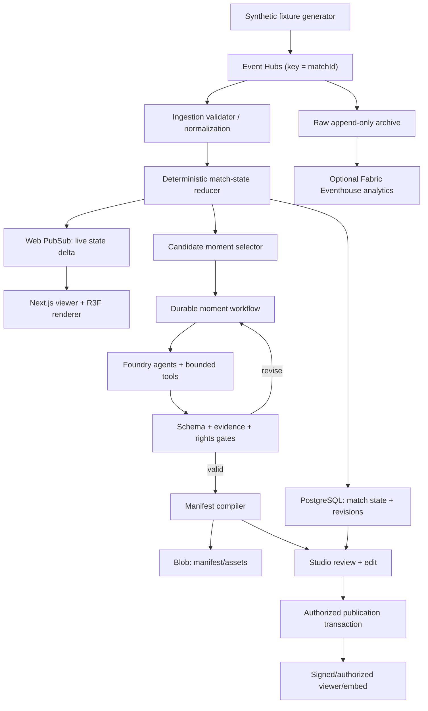

# 04 — System architecture: event truth → playable experience

> **State:** Proposed architecture. No services are claimed as deployed.

## Architectural invariants

1. One authoritative, replayable match-state projection is shared by every lens.
2. **Live path never waits for a model.** Slow, variable-cost creative work is separate.
3. Inputs and outputs are typed, versioned, tenant-scoped and attributable to data sources.
4. Agents cannot override deterministic factual verification or publication policy.
5. Approved releases are immutable. New information produces a revision or revocation.
6. A two-founder team must be able to understand, test and operate the core.

## Reference topology

## Separation of planes

**Data plane (fast):** ingest → validate → canonicalize → event-time reduce → broadcast compact state deltas. No LLM calls on this path. The renderer interpolates authoritative timestamped samples client-side; it does not compute tactical state via an LLM.

**Experience plane (durable):** moment candidate → agents/tools → constrained draft → deterministic and editorial validation → revision → signed release. Latency is measured separately from live-update latency.

**Control plane:** tenant/role policy, source rights, human approvals, manifest revisions, deployments, billing/quotas (future), audit events.

## Core service boundaries

| Service / module | Owns | Does not own |
|---|---|---|
| Ingestion adapter | Validate, identify, archive, canonicalize source event | Causal interpretation |
| Match reducer | Source-of-truth event-time state and deterministic metrics | Language output or visual styling |
| Candidate selector | Bounded interest scoring / meaningful moment window | Publishing |
| Agent worker | Claim proposals, directed visual plans, lens variants | Objective calculation or authority decisions |
| Evidence gate | Source references, numerical consistency, status classification | Claim creative wording |
| Manifest compiler | Valid, safe, renderer-compatible scene description | Client execution of model-created code |
| Studio backend | Draft edits, approval requests, revision conflicts | Raw tracking truth |
| Publication service | Rights, authorization, immutable releases, revocation | Freeform agent autonomy |
| Viewer SDK | Render authorized manifest and associated data | Cross-tenant data access |

## Event processing and ordering

Partition by `matchId` to preserve per-match arrival ordering in the event stream. **Arrival ordering is not event-time ordering.** Reducer sorts/handles source timestamps and bounded lateness by defined policy; ingestion de-duplicates by provider + event ID + revision. Late updates create new match-state revisions and trigger affected moment invalidation.

**Storage semantics:** event hub retention is not durable product archive by itself. Persist the received envelope to append-only object storage, alongside validated canonical events and reducer checkpoints. Never silently rewrite a published historical source.

**Delivery semantics:** assume at-least-once ingestion and worker execution. Achieve *effectively once per business action* with deterministic idempotency keys and transactional uniqueness, not claims of universally exactly-once distributed delivery.

## Critical idempotency keys

- `event_key = provider_id / fixture_id / source_event_id / revision`
- `candidate_key = match_id / event_window_start / event_window_end / reducer_revision / detector_version`
- `manifest_key = moment_id / compiler_version / input_hash / draft_revision`
- `publish_key = tenant_id / release_id / approved_manifest_hash`

Publishing must atomically persist the approved release and an outbox dispatch record. Retries must not publish duplicate releases. Outbox delivery must also be idempotent at consumers.

## Match correction procedure

1. Append correction envelope referencing superseded source event.
2. Recompute affected state in deterministic replay from latest valid checkpoint.
3. Identify downstream manifests depending on revised evidence.
4. Mark drafts stale; published versions are **not silently mutated**.
5. Re-validate releases; revoke or issue an explicitly approved new release where necessary.
6. Emit audit event and notify authorized producer.

## Contracts, schemas, and validation

- Public events: [05](05-data-and-event-contracts.md)
- Generated output: [06](06-moment-manifest.md)
- Agent tool and review handoffs: [07](07-agent-orchestration.md)
- Visual engine: [08](08-3d-engine.md)
- Tenant/policy controls: [10](10-security-and-rights.md)

Validate data at every trust boundary. Use runtime schemas (e.g. Zod/JSON Schema) with CI fixtures and migration tests. Source-controlled versions, compatibility tests and backward-read behavior are mandatory.

## Failure modes

| Failure | Required safe behavior |
|---|---|
| Event hub unavailable | Buffer within bounded capacity, surface stream degraded, no fabricated updates |
| Duplicate/out-of-order event | No duplicate facts, deterministic state after replay |
| Tracking missing | Events-only/2D fallback; mark missing spatial confidence |
| Foundry unavailable/timeouts | Live path continues; experience job retries or status moves to `needs_review` |
| Agent unsupported numerical claim | Rejection; agent revision bounded by retry budget |
| Asset missing | Block publication or serve explicit non-3D fallback |
| Producer edits stale revision | Conflict response with latest revision; no destructive overwrite |
| Unauthorized publish | Server-side 403, auditable denial |
| Revocation propagation delay | Authorized viewer checks release status; cache TTL and invalidation plan defined |

## Reliability and scaling

Start with one match and small fixtures, then test 1, 10, 100 simulated streams. Measure ingestion lag, per-match reducer lag, invalidation latency, publication end-to-end, WebSocket fan-out, compile p95/cost. Scale workers on stream backlog; keep per-match state ownership deterministic. Avoid adding Kafka/Fabric/Cosmos just to increase service count.

**ADR:** [dual path](decisions/0001-dual-path-architecture.md) · [typed manifest](decisions/0002-typed-manifest.md).