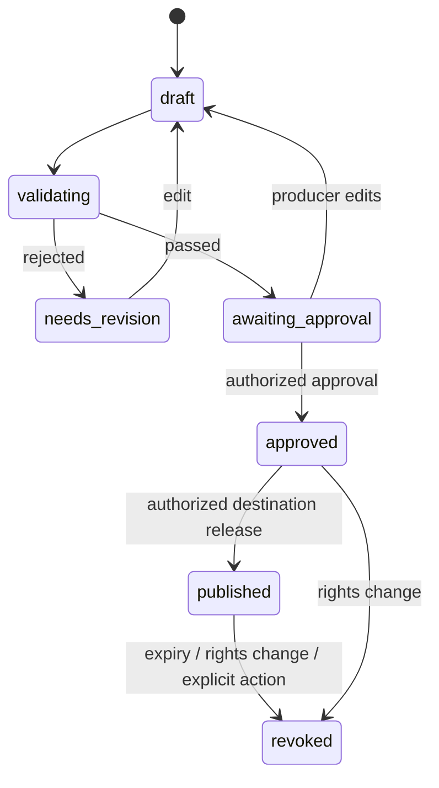

# 06 — Moment Manifest: the center of the platform

> **Status:** v0.1 proposal. Must become versioned JSON Schema / runtime types, tests and sample fixtures before frontend/backend implementation. Current examples are **not executable code**.

## Why this exists

The model does not deliver a video, execute JavaScript or directly manipulate a Three.js scene. It proposes a **declarative, allowlisted scene specification**. A deterministic compiler validates it and a viewer renders it. This keeps the scene reproducible, editable, auditable and portable.

**One manifest is the common contract** among agents, 3D engine, Studio, evidence verifier and publication SDK.

## A minimal illustrative manifest

```json
{
  "schemaVersion": "0.1.0",
  "manifestId": "mom-synthetic-78m",
  "tenantId": "demo-org",
  "matchId": "synthetic-derby-01",
  "revision": 1,
  "status": "draft",
  "timeRangeMs": [4717000, 4731000],
  "input": {
    "reducerRevision": "state-rev-11",
    "sourceEventIds": ["evt-0042"],
    "trackingSampleRefs": ["frame-47170", "frame-47310"],
    "sourceHash": "sha256:PLACEHOLDER_NOT_A_REAL_HASH"
  },
  "scene": {
    "coordinateSystem": "pitch-meters-center-origin-v1",
    "cameraTracks": [{
      "id": "cam-01",
      "mode": "overhead",
      "startMs": 0,
      "endMs": 14000,
      "keyframes": [
        { "tMs": 0, "position": [0, 46, 48], "target": [0, 0, 0], "fovDeg": 48 },
        { "tMs": 14000, "position": [12, 35, 25], "target": [21, 0, 2], "fovDeg": 43 }
      ]
    }],
    "overlays": [{
      "id": "ov-01",
      "kind": "distance",
      "startMs": 6000,
      "endMs": 11000,
      "metricRef": "metric-defender-separation-01",
      "evidenceIds": ["evidence-01"]
    }]
  },
  "claims": [{
    "id": "claim-01",
    "text": "The defender separation increased during the run.",
    "status": "calculated",
    "evidenceIds": ["evidence-01"],
    "language": "en"
  }],
  "evidence": [{
    "id": "evidence-01",
    "kind": "derived_metric",
    "ref": "metric-defender-separation-01",
    "algorithmVersion": "separation-v1",
    "inputRefs": ["frame-47170", "frame-47310"]
  }],
  "lenses": ["fan", "analyst", "accessible"],
  "rightsPolicyRef": "demo-synthetic-policy-v1",
  "approval": null
}
```

**Note:** the sample hash is intentionally a placeholder; compute real content hashes in the implementation. `approval` becomes a typed, server-issued record tied to a specific manifest hash, never a client-set boolean.

## Required type families

`MatchInputRef`: match/reducer revision, source hashes, sample window and provenance.

`CameraTrack`: allowed mode, bounded keyframes, easing policy, safe focal ranges, viewport constraints.

`VisualOverlay`: enumerated kinds (`distance`, `trajectory`, `zone`, `event_marker`, `caption`, `source_quality`), time range, spatial references and evidence links.

`Claim`: ID, status (`observed`, `calculated`, `hypothesis`), localized text, evidence refs, inference disclosure.

`AudienceVariant`: language, verbosity, accessible narration/captions and per-lens layer visibility—**not** modified football truth.

`RightsPolicy`: input/asset license references, approved tenant, destination allowlist, expiry, geo or other restrictions where applicable.

`Release`: immutable `manifestHash`, `approvedBy`, `approvedAt`, `policyVersion`, `releaseId`, revocation state, audit correlation.

## Validation gates: reject by default

1. **Schema:** valid semver, required IDs, finite coordinates, sane durations, no excessive arrays or unknown commands.
2. **Reference:** every entity and metric exists in the named input revision, and is authorized for current tenant.
3. **Temporal:** keyframes monotonic, within moment, overlays inside allowed time ranges; trajectories do not exceed available data.
4. **Evidence:** numerical claims have computable metric links; hypotheses are explicitly labeled; no unreferenced “verified” statement.
5. **Visual:** camera poses within allowed constraints, asset allowlist, overlays below budget; avoid nausea/occlusion and invalid target.
6. **Rights:** input source, asset and destination permitted for the publisher/tenant.
7. **Approval:** only an authorized server action can approve a hash of a validated manifest.

If invalid, emit structured errors with field paths and actionable diagnostics, not silent correction. An agent may be asked to revise within a bounded budget.

## Revision and publication state machine



**Rules:**
- `published` never points to a mutable `draft` version.
- Editor saves use optimistic concurrency (`If-Match`/expected revision).
- Any input evidence correction invalidates relevant claims; published releases are flagged/revoked or replaced by *new* approved versions.
- Revoked URLs stop granting access even if cached assets persist briefly; protect source assets separately.

## Compiler acceptance tests

- A valid fixture produces equivalent rendering instructions every replay.
- Unknown overlay kind or malicious asset URL is rejected.
- Claim with no evidence cannot be `observed` or `calculated`.
- Camera values containing NaN or unsafe duration are rejected.
- Rights mismatch cannot enter `approved`.
- Stale revision rejects editor save.
- Changing one claim changes hash and requires new approval.
- Lens toggling never mutates `input`, geometry or verified metrics.

**ADR:** [typed manifests over executable AI scene code](decisions/0002-typed-manifest.md).