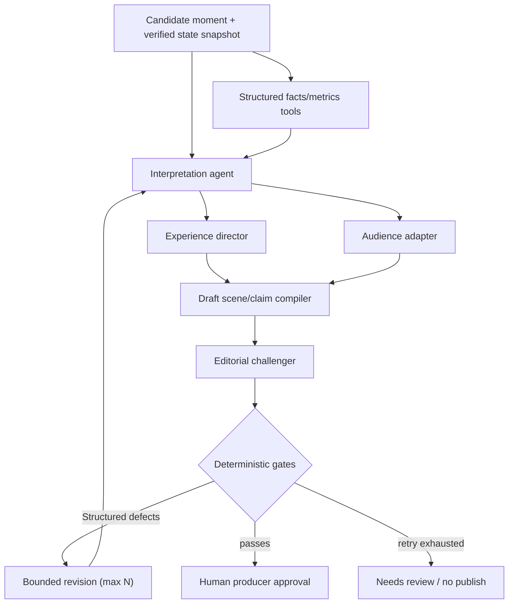

# 07 — Agentic workflow: creative intelligence, bounded by facts

> **Status:** Planned Microsoft Foundry / Microsoft Agent Framework workflow. **No active Foundry project or successful agent run is asserted.**

## Design principle

Agents should solve *creative and interpretation problems*. Deterministic services solve *measurement, matching, permissions, and publication*. Increasing the number of agents is not a measure of quality.

## Workflow diagram

Each invocation receives an immutable input hash, correlation ID, tenant scope, allowed tool list, JSON schema target, time/token budget and prompt/tool version.

## Specialized agents

| Agent | Inputs | Typed output | Allowed tools | Failure posture |
|---|---|---|---|---|
| **Interpretation** | Verified match state, metric/evidence refs, source-quality metadata | Claim candidates, status, source links, uncertainty | Read-only metric lookup and evidence query | Return `insufficient_evidence`, not invention |
| **Experience Director** | Candidate claims, timeline, player IDs and scene capabilities | Camera plan, overlay plan, time cuts | Read-only camera feasibility validator, scene-layer catalog | Downgrade to safe overhead scene |
| **Audience Adapter** | Approved semantic claims + audience preferences | Language/verbosity, caption and accessible-audio scripts | Terminology/locale check; no source mutation | Fall back to base-language transcript |
| **Editorial Challenger** | Compiled draft + facts + policy findings | Defects with severity, cited claim IDs, suggested revisions | Read-only verification results | Block unsupported or ambiguous release |
| **Deterministic verifier (not an agent)** | Canonical inputs + proposed manifest | Pass/fail + exact field error paths | Versioned source DB, numerical calculators, policy engine | Fail closed on authorization/fact violations |

A policy failure cannot be resolved by persuasive model prose.

## Important tool contracts

**`get_metric(matchId, reducerRevision, metricId)`** → number, units, algorithm version, sample refs, provenance quality.

> **Status update (KYN-12, implemented):** this tool contract now exists as the deterministic `kyneloom-get-metric-v1` boundary (`packages/match-core/src/intelligence/agent-tool.ts`) behind `POST /api/agent/metric` (server-only route): allowlisted match sources, strict query grammar, revision-aware 409s, full `MetricResult` provenance and a deterministic `validateClaim` policy that refuses causal objectives outright. See [docs/21 — Football intelligence](21-football-intelligence.md) and the reproducible trace (`pnpm intelligence:demo`, committed as `qa/intelligence-trace.txt`). No Foundry connectivity is claimed — the boundary is exactly this local, auditable tool.

**`get_event_window(matchId, fromMs, toMs)`** → bounded canonical event set with source IDs.

**`validate_camera_plan(plan, sceneBounds)`** → feasibility report including clipping, missing target or unsupported modes.

**`validate_claims(claims, inputHash)`** → typed verdict: `supported`, `hypothesis_only`, `unsupported`, `needs_review`.

**`compile_manifest(draft, schemaVersion)`** → deterministic manifest or structured validation errors.

> **Status update (KYN-16, implemented):** this tool contract now exists as `@kyneloom/moment-compiler` (`compileMomentProposal`) behind `POST /api/moment/compile`: typed untrusted `MomentProposal` in, trusted content-hashed `MomentManifest` draft + broadcast/recap derivations out, or `ContractValidationError[]` with exact field paths. The untrusted proposal schema and the full KYN-15 handoff contract (input hashes, evidence refs, allowed tools, error vocabulary, revision identity) are documented in [docs/22 — Moment compiler](22-moment-compiler.md). No Foundry connectivity is claimed; the committed corpus proposals are labeled `local-deterministic`.

**Not allowed:** arbitrary SQL, unscoped blob access, freeform HTTP/browser navigation to unknown hosts, uncontrolled code execution, publication tools on agent credentials.

## Durable execution

Prefer Microsoft Agent Framework workflows with durable backing/checkpointing (or Durable Extension with managed durable infrastructure) for jobs that can pause, restart, and await review. Do **not** conflate ordinary in-memory checkpoint storage with cross-process distributed durability.

**Job states:** `queued` → `running` → `draft_ready` → `validation_failed/needs_revision` → `awaiting_approval` → `completed`; orthogonal terminal `failed` and `cancelled`.

- Idempotency key based on moment/input hash/workflow version.
- Persist completed executor outputs and hashes to avoid repeating externally visible operations.
- Set bounded retries with jitter for transient transport failures.
- Set a separate semantic revision budget (e.g. 2) for unsupported claims.
- Human approval is a **server-side authorized action**, not a language-model tool.
- Use trace correlation across source event, reducer, agent steps, compiler, publication transaction.

## Shared state should be small and typed

Use structured `MomentContext` with match ID/reducer revision, candidate time range, selected metric IDs, selected claims, scene draft URI/hash, current validation findings, per-agent result metadata. Agents pass **references to bounded evidence** rather than huge event dumps. PII is excluded by default; source permissions enforced in every tool.

## When agents disagree

The system does not vote on factual claims. If one agent proposes a statistical statement and another questions it, the deterministic numerical verifier adjudicates. If a tactical claim is plausible but not provable, publish only with hypothesis language and editorial approval, or omit.

## Evaluation harness

Baseline A: deterministic template description with no agent.

Baseline B: one constrained model generating claims + scene plan.

Candidate C: specialized bounded workflow.

Score independently on:
- **Factual support**: proportion of objective claims with verified metrics; unsupported claim escape rate (target zero for designed test corpus).
- **User comprehension**: blinded human judgments about clarity / useful insight.
- **Composition quality**: feasibility of camera plan, layer overlap, clip readability, duration.
- **Operational reliability**: recovery after worker interruption, deduplication, retry count.
- **Efficiency**: end-to-end p50/p95, tool count, tokens and cloud cost per valid release.

Report comparable scenarios and confidence intervals where appropriate. No claim that multi-agent outperforms a baseline without measurement.

## The grand-prize failure demonstration

Inject an attractive but false claim ("the defender was 14 meters away"). The Interpretation agent suggests it. The verifier reads the source frames and rejects the unsupported number. The challenger requests revision. The corrected draft replaces the statistic and explicitly labels the tactical inference; the viewer receives only the valid version. Demonstrate with real traces and a live state transition.

**References:** [Microsoft Agent Framework checkpoints](https://learn.microsoft.com/en-us/agent-framework/workflows/checkpoints) · [Durable Extension](https://learn.microsoft.com/en-us/agent-framework/integrations/durable-extension) · [Evaluation](11-evaluation-and-reliability.md).