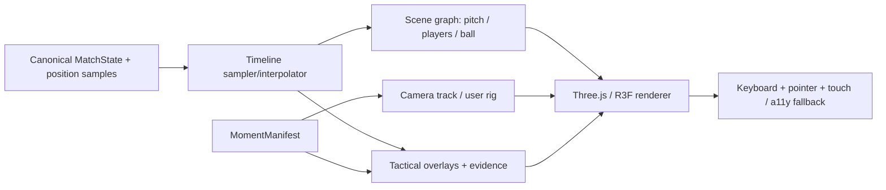

# 08 — Living Replay: spatial renderer specification

> **Status:** Planned. Existing earlier concept art and SVG interaction sketches are not real tracking-powered 3D.

## Desired user sensation

The scene should feel **elastic, continuous and tactile**: smoothly move from an overhead tactical composition to a player-follow camera, freeze at the precise frame, orbit the scene and reveal spatial meaning without losing time context.

But camera cinematography is separate from football truth. The camera can move freely; the player coordinates must remain the same canonical state for time `t`.

## Scene architecture

**Recommended:** Next.js shell; React Three Fiber + Three.js for scene; Drei where it reduces real complexity; GSAP/Motion only for UI/camera choreography as appropriate; Blender glTF assets; a 2D SVG/Canvas fallback using the same sampled match state.

## Coordinate transform

World source uses meters, pitch center origin, `x` lengthwise, `y` widthwise, `z` up. Three.js commonly uses `y` up. **Implement exactly one tested transform** such as `(worldX, worldY, worldZ) = (srcX, srcZ, -srcY)`. Never independently swap axes in camera, players and overlays.

The same function must be exercised by fixtures for left/right and period direction switching.

## Time model

`playheadMs` is the single source of truth. Sampling is `sampleAt(matchState, playheadMs)`. Animation time is **not** network wall-clock time, React render time or GSAP elapsed time.

- Use timestamp-based interpolation between valid samples. Start with linear positions; use Hermite only when velocities and constraints are validated.
- For long gaps, identity ambiguity and occlusion: freeze/fade or switch to 2D; explicitly mark extrapolated state.
- Use fixed timestamps and seed for deterministic replay. Minimize cumulative floating-point drift by computing current pose from `playheadMs`, not integrating from previous visual frame.
- 0.25×, 0.5×, 1×, 2× playback plus frame-step and pause.
- Reset camera easing and scene-object state cleanly on large seeking jumps.

## Camera system

| Mode | Behavior | Safety |
|---|---|---|
| Overhead tactical | Wide orthographic or calibrated perspective over whole pitch | Keep pitch boundaries in view |
| Broadcast | Low offset, panoramic camera following ball/selected play | Avoid occlusion and abrupt FOV |
| Player follow | Tracking focus behind/above chosen player | No claim that it recreates human eye viewpoint without camera calibration |
| Goalkeeper | Framing from goalkeeper locality and scene target | Prevent geometry clipping |
| Free orbit | User controls orbit/pan/zoom with damping | Clamp pitch penetration and motion bounds |
| Directed | Keyframe camera path from validated manifest | Validate velocity/ease/FOV/collision envelope |

**Elastic camera:** interpolate target and position via damped springs, clamp angular velocity, use collision/raycast checks, and preserve timeline position. In reduced-motion mode, shorten/snap transitions and disable ornamental travel.

## Animation fidelity

Basic 10 Hz tracking does not reveal an athlete's true limb poses. Use simplified articulated characters with grounded procedural locomotion and heading interpolation, and **do not claim biomechanical motion reconstruction**. For ball, use physically plausible synthetic trajectories from fixture generator; do not fabricate an observed ball arc from discrete pass events.

Visual layers: physical objects, selection outline, evidence trajectory, source quality markers, event markers, captions. Each layer has explicit timing and scene-object references.

## Performance budget (targets, not results)

- Cap draw calls via instancing for crowds, benches and repeated objects; reuse geometry/materials.
- Use GLB/glTF with texture compression, lazy-load noncritical assets, restrict shadow casters, scale DPR by device tier.
- Avoid per-frame React state churn; use refs/frameloop for high-frequency transforms.
- Keep overlay shaders bounded and batch lines/markers.
- Instrument frame-time p50/p95 and memory; aim for 60 FPS desktop and 30 FPS graceful mobile fallback.
- On poor hardware, disable post-processing/crowds and switch to simple geometric players or 2D.

## Geometry and semantic quality gates

1. Scrubbing to `t` always returns identical pose across camera modes.
2. Player IDs remain stable; selected player persists between lenses and views.
3. Evidence trajectory anchored to actual sample IDs or labeled interpolation.
4. No geometry crosses pitch bounds due to incorrect coordinate transforms.
5. The “follow” camera does not occlude the selected player beyond tolerated intervals.
6. UI controls work with keyboard, touch, accessible transcript and 2D view.
7. Inspect snapshots at 1440×900, 1024×768 and 390×844; fix layout *and* scene semantics.
8. Benchmarks measured on stated devices, using repeatable fixtures.

## Reference engineering patterns

- [React Three Fiber scaling/performance](https://r3f.docs.pmnd.rs/advanced/scaling-performance)
- [Three.js docs](https://threejs.org/docs/)
- [SkillCorner positional sample format](https://github.com/SkillCorner/opendata)
- [Codrops 3D engineering articles](https://tympanus.net/codrops/)

Inspect licenses and actual source for visual inspiration. Never paste licensed assets or protected broadcast footage into the project without permission.

**Related:** [Moment Manifest](06-moment-manifest.md) · [Design rules](03-design-system.md) · [Event truth](05-data-and-event-contracts.md).