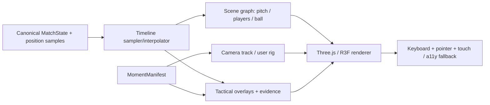

# 08 — Living Replay: spatial renderer specification

> **Status (KYN-08, 2026-10-17): Evidence X-Ray is IMPLEMENTED (review round closed).** Select a player, press **X-Ray** (or `X`) and the measured defender–striker separation appears as world-anchored geometry — solid mint for the two measured states (before/after), a dashed-amber trail for the decoy run (hypothesis), a floating `6.306 m → 20.344 m` label — all on the same playheadMs/identities/pitchToThree as the scene. **Clicking or tapping the measured geometry itself** (adequately sized invisible hit boxes along both lines, plus the label) opens the evidence inspector without disturbing selection; the X-Ray / Show evidence buttons and `X`/`I` keys remain the accessible alternatives, and the 2D fallback's measurement line is clickable with the same effect. The inspector shows: plain-language calculation, interval, source frame IDs on demand, algorithm version, provenance, verification fingerprint, and the explicitly-labeled interpretation boundary. The evidence object is the reducer's own `SeparationEvidence` (computed + re-verified server-side in `lib/evidence-data.ts`), and the client gate is two-layered and throw-free for arbitrary payloads: strict shape guards, then AUTHORITATIVE BINDING — the payload must equal what `separationFromTimeline` recomputes from the scene's own timeline (identities, window, frame refs, dependencies, fingerprint, hypothesis boundary) and must pass the existing `verifySeparationEvidence` against the scene's accepted tracking; arithmetic consistency alone never suffices. A documented SOURCE-QUALITY POLICY gates the four raw endpoint samples before any measurement is presented: exactly one accepted sample per (entity, time) (ambiguous identity withholds), `tracked` visibility only, confidence ≥ 0.9, and `synthetic_ground_truth` origin only — observed or mixed provenance is WITHHELD rather than mislabeled (see `SOURCE_QUALITY_POLICY` in `lib/evidence-data.ts`). All owned Three.js resources (line geometries, materials, label texture) are memoized once per evidence/activation and disposed on change/unmount, so repeated toggling and phase switching stay allocation-free. Verification or policy failure withholds the measurement. See `scene/xray-overlay.tsx`, `evidence-inspector.tsx`.
>
> **Status (KYN-07, 2026-10-16): the elastic camera rig is IMPLEMENTED.** Six modes — broadcast, overhead, follow, goalkeeper (framed from the ENGAGED keeper's actual position), free orbit and manifest-directed — with exactly one active driver per frame, frame-rate-independent seconds-domain damping of position/target/fov, safety clamps (never underground, inside the stadium, clear of players), keyboard 1–6 + global-Escape exit, touch orbit, and a validated canonical `CameraTrack` (the authored "Invisible Assist" sequence) parsed through `parseManifestCameras` with offset→absolute clock conversion done exactly once. See `apps/web/src/app/explore/scene/camera-rig.tsx`, `camera-track.ts`, `camera-safety.ts`.
>
> **Status (KYN-06, 2026-10-14): the Living Replay core is IMPLEMENTED.** `/explore` mounts a real R3F/Three scene (105×68 m pitch, goals, turf, floodlights, textured ball) driven by a single `playheadMs` owner on the server-serialized golden fixture; four cameras, click-to-select with stable identity, full transport (play/pause/step/scrub/0.25–2×), a same-timeline 2D fallback, and QA hooks proving camera-independent world truth. See `apps/web/src/app/explore/scene/` and [16 — Visual QA](16-visual-reference-and-qa.md). Sections below remain the binding specification (cameras beyond the four shipped modes — goalkeeper/directed tracks — stay planned for Issues #7/#8).

## Desired user sensation

The scene should feel **elastic, continuous and tactile**: smoothly move from an overhead tactical composition to a player-follow camera, freeze at the precise frame, orbit the scene and reveal spatial meaning without losing time context.

But camera cinematography is separate from football truth. The camera can move freely; the player coordinates must remain the same canonical state for time `t`.

## Scene architecture

**Recommended:** Next.js shell; React Three Fiber + Three.js for scene; Drei where it reduces real complexity; GSAP/Motion only for UI/camera choreography as appropriate; Blender glTF assets; a 2D SVG/Canvas fallback using the same sampled match state.

## Coordinate transform

World source uses meters, pitch center origin, `x` lengthwise, `y` widthwise, `z` up. Three.js commonly uses `y` up. **Implement exactly one tested transform** such as `(worldX, worldY, worldZ) = (srcX, srcZ, -srcY)`. Never independently swap axes in camera, players and overlays.

> **Implemented (KYN-02):** the single transform is `pitchToThree`/`threeToPitch` in [`packages/contracts/src/spatial.ts`](../packages/contracts/src/spatial.ts) — hand-checked (corner flag `(52.5, 34, 0) → (52.5, 0, -34)`), round-trip tested, and consumed by `scene-renderer`'s `parseManifestCameras`, which converts manifest camera tracks (pitch meters, z up) into Three-space keyframes without touching time offsets.

The same function must be exercised by fixtures for left/right and period direction switching.

## Time model

> **Implemented (KYN-04):** `createTimeline(tracking)` → `timeline.sampleAt(timeMs)` in `packages/match-core/src/reducer/timeline.ts`. Rules: exact samples return verbatim (original frame ids and origin); between same-entity samples ≤ 400 ms apart, a linear interpolation is returned disclosed as `interpolated` with both frame ids and method; before the first sample, after the last, or across larger gaps the position is MISSING (explicitly absent — no stale poses, no extrapolation, full time beyond the emitted window is missing by construction). Every query is recomputed from samples, so repeated seek/rewind/pause/out-of-order queries cannot drift. Positions stay in canonical pitch meters; `pitchToThree` remains the only renderer conversion; camera state never touches this layer.

`playheadMs` is the single source of truth. Sampling is `sampleAt(matchState, playheadMs)`. Animation time is **not** network wall-clock time, React render time or GSAP elapsed time.

- Use timestamp-based interpolation between valid samples. Start with linear positions; use Hermite only when velocities and constraints are validated.
- For long gaps, identity ambiguity and occlusion: freeze/fade or switch to 2D; explicitly mark extrapolated state.
- Use fixed timestamps and seed for deterministic replay. Minimize cumulative floating-point drift by computing current pose from `playheadMs`, not integrating from previous visual frame.
- 0.25×, 0.5×, 1×, 2× playback plus frame-step and pause.
- Reset camera easing and scene-object state cleanly on large seeking jumps.

## Camera system

| Mode | Behavior | Safety |
|---|---|---|
| Overhead tactical | Wide orthographic or calibrated perspective over whole pitch | Keep pitch boundaries in view |
| Broadcast | Low offset, panoramic camera following ball/selected play | Avoid occlusion and abrupt FOV |
| Player follow | Tracking focus behind/above chosen player | No claim that it recreates human eye viewpoint without camera calibration |
| Goalkeeper | Framing from goalkeeper locality and scene target | Prevent geometry clipping |
| Free orbit | User controls orbit/pan/zoom with damping | Clamp pitch penetration and motion bounds |
| Directed | Keyframe camera path from validated manifest | Validate velocity/ease/FOV/collision envelope |

**Elastic camera:** interpolate target and position via damped springs, clamp angular velocity, use collision/raycast checks, and preserve timeline position. In reduced-motion mode, shorten/snap transitions and disable ornamental travel.

## Animation fidelity — realistic production, honest reconstruction

**The finished fan replay must use realistic rigged humanoid footballers, not circles or capsules.** Markers are only an initial development visualization or optional tactical overlay. The detailed, source-backed pipeline is in **[19 — Realistic Football Character Pipeline](19-realistic-character-pipeline.md)** and [issue #30](https://github.com/CosmasMandikonza/Kyneloom/issues/30): licensed model → Mixamo or valid motion library → Blender rig/uniform cleanup → GLB with named skinning animation clips → geometry/texture optimization → `GLTFLoader` → independent instances via `SkeletonUtils.clone` → blended `AnimationMixer` motion states.

**Authoritative world-space root motion** still comes strictly from tracking/synthetic positions at `playheadMs`. Clip animation belongs in local skeleton pose; use in-place clips or strip root movement to avoid double movement. Speed and heading select idle/jog/sprint/turn; relevant fixture event may select shoot/pass animation where supported. Scrubbing must compute pose deterministically. Basic 10 Hz tracking does **not** reveal an athlete's exact real limb poses: characterize local animation as reconstructed/presentation, not observed biomechanics.

Build two fictional team kits, goalkeeper variant, physically based lighting/textured ball and cinematic stadium, with LOD and 2D fallback. For ball use coherent source/synthetic trajectory, not arbitrary flourish from event-only input. **Issue #6 cannot be declared finished with anonymous circles; #30's rigged-player visual gate must pass.**

Visual layers: physical objects, selection outline, evidence trajectory, source quality markers, event markers, captions. Each layer has explicit timing and scene-object references.

## Performance budget (targets, not results)

- Cap draw calls via instancing for crowds, benches and repeated objects; reuse geometry/materials.
- Use GLB/glTF with texture compression, lazy-load noncritical assets, restrict shadow casters, scale DPR by device tier.
- Avoid per-frame React state churn; use refs/frameloop for high-frequency transforms.
- Keep overlay shaders bounded and batch lines/markers.
- Instrument frame-time p50/p95 and memory; aim for 60 FPS desktop and 30 FPS graceful mobile fallback.
- On poor hardware, disable post-processing/crowds and switch to simple geometric players or 2D.

## Geometry and semantic quality gates

1. Scrubbing to `t` always returns identical pose across camera modes.
2. Player IDs remain stable; selected player persists between lenses and views.
3. Evidence trajectory anchored to actual sample IDs or labeled interpolation.
4. No geometry crosses pitch bounds due to incorrect coordinate transforms.
5. The “follow” camera does not occlude the selected player beyond tolerated intervals.
6. UI controls work with keyboard, touch, accessible transcript and 2D view.
7. Inspect snapshots at 1440×900, 1024×768 and 390×844; fix layout *and* scene semantics.
8. Benchmarks measured on stated devices, using repeatable fixtures.

## Reference engineering patterns

- [React Three Fiber scaling/performance](https://r3f.docs.pmnd.rs/advanced/scaling-performance)
- [Three.js docs](https://threejs.org/docs/)
- [SkillCorner positional sample format](https://github.com/SkillCorner/opendata)
- [Codrops 3D engineering articles](https://tympanus.net/codrops/)

Inspect licenses and actual source for visual inspiration. Never paste licensed assets or protected broadcast footage into the project without permission.

**Related:** [Moment Manifest](06-moment-manifest.md) · [Design rules](03-design-system.md) · [Event truth](05-data-and-event-contracts.md).