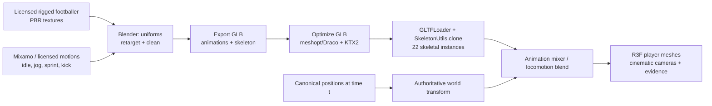

# 19 — Realistic football character pipeline (source-backed build specification)

> **Status (KYN-30, 2026-10-14): IMPLEMENTED for the golden replay.** The Explore surface now renders 22 independently animated skinned humanoids (CC0 Quaternius base rig, 65-bone skeleton, ~0.8 MB GLB), fictional home/away/goalkeeper kit tints, idle/walk/jog/sprint locomotion blended from tracking speed plus an authored pass/shot clip — every clip a deterministic pure function of `playheadMs`. Rights are recorded in the [asset rights ledger](asset-ledger.md); the reproduction pipeline is `scripts/build-player-asset.mjs`. What remains NOT claimed: captured biomechanics (10 Hz tracking cannot provide them — all limb motion is labeled reconstructed presentation), foot-ground IK, and crowd LOD. The text below remains the source-backed specification.
>
> **Decision:** **The production-quality replay uses rigged human football player meshes and genuine 3D environments.** Circles/markers may exist as a temporary tactical abstraction or developer debugging aid, **never as the default finished fan replay**.

## The workflow: leverage established 3D pipelines

**Verified source capabilities:**

- [Adobe Mixamo rigging](https://helpx.adobe.com/creative-cloud/help/mixamo-rigging-animation.html) and [Mixamo usage FAQ](https://helpx.adobe.com/creative-cloud/faq/mixamo-faq.html). Mixamo supports humanoid auto-rigging and ready-made motion clips under published terms, subject to redistribution limits. Do **not** assume that all soccer-specific motion clips exist.
- [Blender glTF export](https://docs.blender.org/manual/en/3.6/addons/import_export/scene_gltf2.html): export skinning and named animation actions/NLA clips to GLB.
- [Three.js SkinnedMesh](https://threejs.org/docs/pages/SkinnedMesh.html): bones, skeleton, skin weights.
- [Three.js SkeletonUtils](https://threejs.org/docs/pages/module-SkeletonUtils.html): skinned-character clones with separate bone hierarchies and shared geometry/materials; `retargetClip` if rigs differ.
- [Three.js AnimationMixer](https://threejs.org/docs/pages/AnimationMixer.html), [R3F/Drei useAnimations](https://drei.docs.pmnd.rs/abstractions/use-animations): per-character animation actions and blending.
- [Official Three.js multiple skinned characters demo](https://threejs.org/examples/webgl_animation_multiple.html): concrete multi-character sample.
- [glTF Transform](https://gltf-transform.dev/): `meshopt`, Draco, KTX2 and texture/mesh optimization, with validation after conversion.

## Asset selection gate: do this BEFORE generating player meshes

Choose a **licensed, rigged human footballer** with correct proportions, deformable skinned mesh, clean skeleton, well-placed boots and clothing materials. For two fictional teams, create coherent jersey colors and player numbers with shared base rig. Avoid licensing active real players, club logos, league marks, protected real footage, or 3D scans without permission.

Candidate asset sources to **evaluate**, not assets we claim to own: Mixamo characters with custom uniforms; appropriately licensed marketplace humanoids/footballers; custom Blender character with Mixamo auto-rig.

### Required assets

| Asset | Acceptance |
|---|---|
| Primary footballer | Clearly human full-body anatomy, skinned/rigged, sensible shoes, UV/PBR materials |
| Kit variations | Two fictional team styles, numbers, goalkeeper variant, no real brand/club marks |
| Motion set | idle, walk, jog, sprint, change direction, pass/shoot, stand/celebrate; add only available, legally usable clips |
| Ball | real sphere geometry with proper football texture, authoritative motion, independent spin |
| Stadium | pitch and goals proportional to meters, turf markings, floodlights, background seating/crowd LOD |
| LOD | high quality near camera; lower-cost distant player and crowd geometry; two-dimensional non-WebGL fallback |

### Asset licensing ledger

Track for each asset: URL, author/vendor, license version, permissible commercial use, attribution, whether redistribution of source/GLB is permitted, whether modified files may ship in a public client bundle, and storage/ownership. **Do not commit paid/raw Mixamo/third-party assets to a public repo if distribution terms disallow it.** Being able to download an asset doesn't establish redistribution rights; the final public build needs a reviewed asset delivery plan.

## Animation correctness

The match data drives **world-space root transforms**. Animations drive a player's **local skeleton pose**.

1. At playhead `t` retrieve authoritative `x,y,z`, heading estimates and event state.
2. Compute velocity from timestamped samples with smoothing and limited gap inference, never interpolate across invalid frame ranges.
3. Map speed/action to animation state: idle, jog, sprint, turn, kick. Use blended transitions and per-player phase offsets.
4. **Use in-place clips**, or strip/compensate animation root motion so player movement is not applied twice.
5. Keep skeleton's local clip time deterministically derived from playhead/time within its action segment (or rebuild clip state on seek) so pause/seek/reverse doesn't accumulate drift.
6. Use contact events to anchor plausible pass/shoot animation and ball timing **only if source/simulator supports it**; don't fabricate a contact frame as observed truth.
7. Add optional foot-ground adjustment/IK only after stable locomotion and frame-rate measurement. Label such secondary biomechanics reconstructed.

**At every camera mode**, player roots at time `t` must be exactly the same. Camera movement and perspective cannot modify facts.

## Rendering targets, not achieved benchmarks

- LOD: realistic near characters, lower complexity for distant 22-player view; cull remote crowd details.
- Shared character geometry/textures, independent skeletons, material variants for kit; measure 22 rigs with actual GPU frame-time.
- PBR materials, believable pitch roughness/lighting, cast shadows budgeted by camera and device.
- Hero desktop aim 60 FPS; graceful mobile aim 30 FPS or 2D fallback, subject to device benchmark.
- Asset budgets measured and recorded (GLB bytes, texture resolution, draw calls, GPU time, first interactive frame).
- Don't use large photoreal assets that make the screen stutter or trap a judge behind a loading spinner.

## Visual proof required to close the character-realism issue

1. Real browser scene screenshot **with 22 clearly humanoid rigged players and a textured ball**, distinct team kits and believable pitch.
2. 8–15-second actual browser recording: static pitch → jog/sprint → decoy-run change of direction → pass/shot → pause + scrub backward → replay forward. Animations remain aligned to trajectory and time.
3. Player-follow camera shows believable model and lighting; overhead tactical view remains clean.
4. One player selection opens actual evidence; no interaction is blocked by PBR material/collision mesh.
5. Mobile low-end mode scales down correctly and provides 2D fallback.
6. Licensing spreadsheet/ledger with verified source links and source-code references; all external runtime assets authorized.
7. All position/geometry and animation assertions tested against the same seeded event fixture.

## Explicitly prohibited implementation shortcuts

- `sphereGeometry`, `circleGeometry` or `capsuleGeometry` as the **final visual body** of a footballer.
- A still image of a player rotated to face camera and described as a 3D replay.
- Independently animating root/player world positions with GSAP based on a story prompt while the reducer has conflicting tracking.
- Making a 10 Hz tracking input look like full-body captured motion without labeling secondary motion as reconstructed.
- A heavyweight “realistic” scene with unusable controls or a missing-data state that hallucinates players.

## Implementation handoff

Realistic asset authoring and asset manifest is [Issue #30 — Rigged football characters](https://github.com/CosmasMandikonza/Kyneloom/issues/30). Tie it into [Issue #6 — Living Replay](https://github.com/CosmasMandikonza/Kyneloom/issues/6). [Issue #7 — Cinematic camera](https://github.com/CosmasMandikonza/Kyneloom/issues/7) and [Issue #8 — Evidence X-Ray](https://github.com/CosmasMandikonza/Kyneloom/issues/8) must operate on the **same** scene/state.

**Related:** [3D engine](08-3d-engine.md) · [Event contract](05-data-and-event-contracts.md) · [Visual reference QA](17-source-verified-frontend.md) · [Audience roles](02-experience-design.md).
